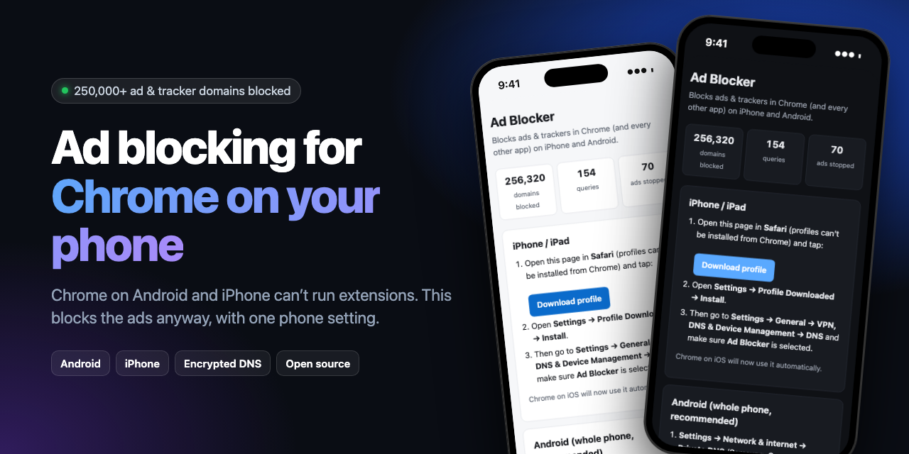
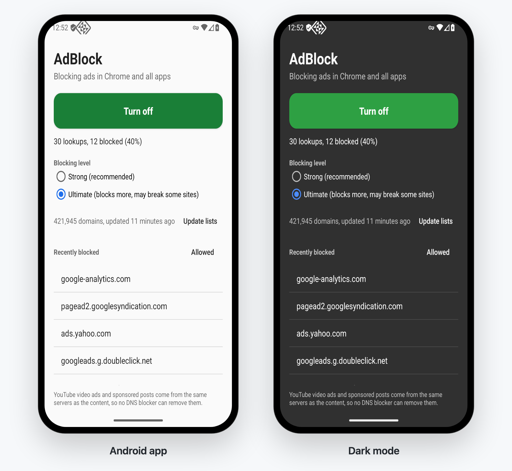
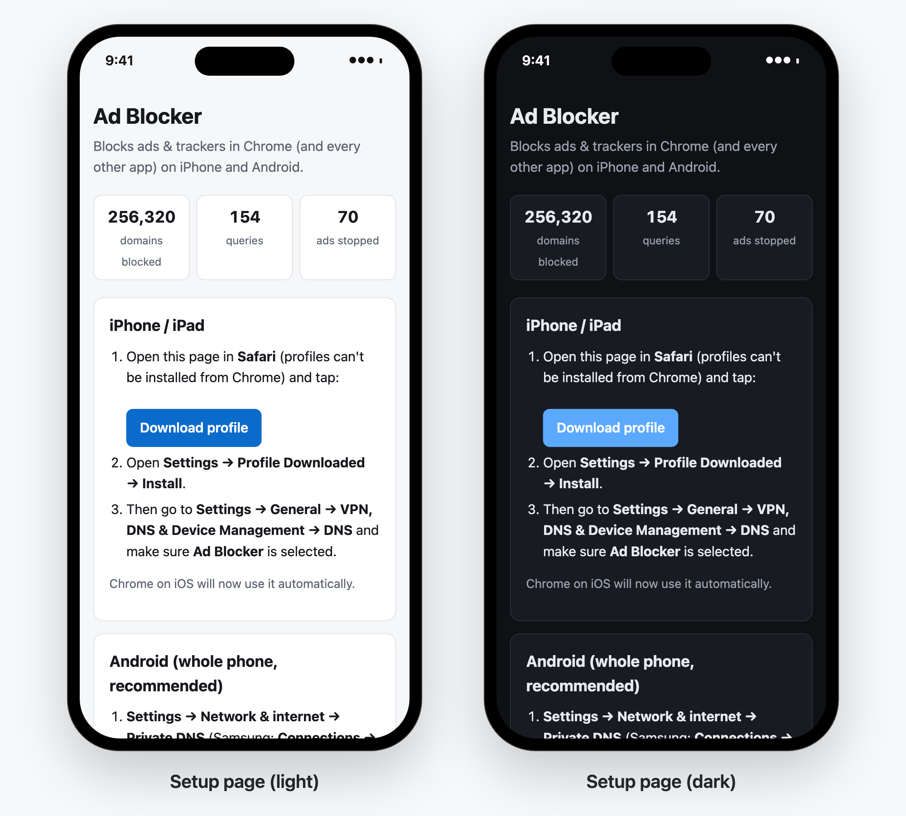
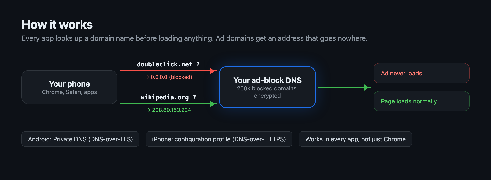

<div align="center">



# Mobile Chrome AdBlock

Block ads in Chrome on Android and iPhone, without extensions.

[](https://github.com/TYFSADIK/mobile-chrome-adblock/actions/workflows/android.yml)
[](https://github.com/TYFSADIK/mobile-chrome-adblock/actions/workflows/ios.yml)
[](https://github.com/TYFSADIK/mobile-chrome-adblock/actions/workflows/ci.yml)
[](LICENSE)

</div>

Chrome on Android doesn't support extensions, and neither does Chrome on iPhone, so there's no uBlock
Origin for the browser most people use on their phone.

What phones do let you control is DNS, the lookup every app does before it loads anything. If the
lookup for `doubleclick.net` comes back empty, the ad never loads. This project does that filtering
with about 400,000 ad, tracker and malware domains, and you can run it whichever way suits you:

| Option | Phone | What you need |
|---|---|---|
| [Android app](#android-app) | Android 8+ | Nothing. Install the APK and tap Turn on. |
| [iPhone profile](#iphone) | iPhone, iPad | Nothing. One tap in Safari. |
| [iPhone app](#iphone) | iPhone, iPad | A paid Apple developer account to sideload it. |
| [Termux](#termux) | Android | Termux. Root is optional. |
| [Your own server](#run-your-own-server) | Both | A VPS and a domain. Covers a whole family. |

Or open **[tyfsadik.github.io/mobile-chrome-adblock](https://tyfsadik.github.io/mobile-chrome-adblock/)**
on your phone for the short version.

## Android app

<div align="center">

</div>

1. Download [**AdBlock.apk**](https://github.com/TYFSADIK/mobile-chrome-adblock/releases/latest/download/AdBlock.apk) on your phone and open it. If Android asks, allow your browser to install apps.
2. Open AdBlock and tap **Turn on**. Android asks once to allow the VPN connection.

That's it. Blocking happens on the phone itself: no account, no server, and nothing leaves your phone
except normal lookups for sites that aren't blocked.

The app shows up as a VPN, but it only carries DNS lookups. Your actual browsing goes straight to the
internet as usual, so it doesn't slow anything down or use extra battery.

- **Two blocking levels.** Strong is the default. Ultimate blocks more but may occasionally break a site.
- **Recently blocked list.** Tap a domain to always allow it if something stops working.
- **Quick Settings tile.** Switch it on and off from the notification shade.
- **Blocks bypass attempts.** Public encrypted DNS servers (Google, Cloudflare and others) are blocked, so apps can't skip the filter.
- **Catches disguised trackers.** Trackers hiding behind a site's own subdomain (CNAME cloaking) are blocked too.
- **Works offline.** The lists are built into the app. Tap Update lists to get the newest ones.

If you've set **Private DNS** to a specific provider in Android settings, that overrides the app. The app
warns you when this happens; set Private DNS back to Automatic.

## iPhone

**The profile (easiest).** Open
[tyfsadik.github.io/mobile-chrome-adblock](https://tyfsadik.github.io/mobile-chrome-adblock/) in
Safari and tap Download profile, then go to Settings > Profile Downloaded > Install. This points your
iPhone at [AdGuard DNS](https://adguard-dns.io), a free public ad-blocking DNS service, so it uses
AdGuard's blocklist rather than this project's. Remove the profile under Settings > General >
VPN, DNS & Device Management to turn it off.

**The app.** [AdBlock.ipa](https://github.com/TYFSADIK/mobile-chrome-adblock/releases/latest/download/AdBlock.ipa)
works like the Android app, blocking on the phone itself with the same lists. It also adds "Turn on
AdBlock" and "Turn off AdBlock" to Siri and the Shortcuts app. The catch is Apple's rule that apps
using the VPN system need a paid Apple developer account ($99 a year), so free sideloading through
AltStore or SideStore won't work. With a paid account, install it with
[Sideloadly](https://sideloadly.io) or build it yourself in Xcode (see [Building](#building)).

## Termux

Install the `adblock` command in [Termux](https://termux.dev):

```bash
curl -fsSL https://raw.githubusercontent.com/TYFSADIK/mobile-chrome-adblock/main/termux/adblock -o $PREFIX/bin/adblock && chmod +x $PREFIX/bin/adblock
```

With the Android app installed (`adblock install-app` downloads it for you):

```bash
adblock on        # start blocking
adblock off       # stop
adblock toggle
adblock status    # "on queries=1520 blocked=431"
```

These work from scripts, Termux:Widget home screen shortcuts, and Tasker too.

**Rooted phones** can skip the app entirely:

```bash
adblock root-on            # or: adblock root-on ultimate
adblock allow example.com  # never block a domain
adblock root-off
```

Root mode runs the blocker inside Termux and uses firewall rules to send every DNS lookup on the
phone to it. It also blocks encrypted DNS on port 853 so nothing slips past. Android caches lookups
for a few minutes, so sites you opened just before turning it on may keep their ads until then.

Without root or the app, Termux can't change the phone's DNS. Android doesn't allow it.

## Run your own server

One server can protect every phone in your family, with no app on any of them. You need a small Linux
VPS (the Oracle Cloud free tier works, or any $4 to $5 VPS) and a domain pointing at it. A free
[DuckDNS](https://www.duckdns.org) subdomain is fine. On the server:

```bash
curl -fsSL https://raw.githubusercontent.com/TYFSADIK/mobile-chrome-adblock/main/install.sh | sudo bash -s dns.yourname.com
```

That installs Docker if needed, opens ports 80, 443 and 853, starts the server and gets a Let's
Encrypt certificate. Then open `https://dns.yourname.com` on each phone:

<div align="center">

</div>

- **Android:** Settings > Network & internet > Private DNS > enter `dns.yourname.com`.
- **iPhone:** open the page in Safari > Download profile > Settings > Install.

<details>
<summary>Other ways to run the server, and its options</summary>

Docker Compose:

```bash
git clone https://github.com/TYFSADIK/mobile-chrome-adblock && cd mobile-chrome-adblock
# replace dns.example.com in docker-compose.yml with your domain
docker compose up -d
```

Docker:

```bash
docker run -d --name adblock --restart unless-stopped \
  -p 80:80 -p 443:443 -p 853:853 -v $PWD/certs:/data/certs \
  ghcr.io/tyfsadik/mobile-chrome-adblock -domain dns.yourname.com
```

Binary from [Releases](https://github.com/TYFSADIK/mobile-chrome-adblock/releases), or `go install github.com/TYFSADIK/mobile-chrome-adblock@latest`:

```bash
sudo ./adblock-dns-linux-amd64 -domain dns.yourname.com
```

| Flag | Default | Description |
|---|---|---|
| `-domain` | none | Public hostname. Turns on HTTPS, DNS-over-TLS and automatic certificates. |
| `-level` | `strong` | `strong` or `ultimate`. |
| `-lists` | none | Comma-separated blocklist URLs or files, replacing the level's lists. |
| `-allowlist` | `allowlist.txt` | Domains that should never be blocked, one per line. |
| `-upstream` | `1.1.1.1:53,9.9.9.9:53` | Where allowed lookups get forwarded. |
| `-refresh` | `24h` | How often to re-download the blocklists. |
| `-log-blocks` | off | Log every blocked domain. Useful when a site breaks. |
| `-dns-addr` | off | Plain DNS listener, e.g. `:53` on a home network. Don't expose it to the internet. |
| `-dev` | off | Local testing without TLS. |

</details>

## How it works



Every option uses the same lists:

| List | Strong | Ultimate |
|---|---|---|
| [StevenBlack hosts](https://github.com/StevenBlack/hosts) | yes | yes |
| [AdGuard DNS filter](https://github.com/AdguardTeam/AdGuardSDNSFilter) | yes | yes |
| [HaGeZi](https://github.com/hagezi/dns-blocklists) Pro++ | yes | |
| HaGeZi Ultimate | | yes |
| HaGeZi encrypted DNS bypass | yes | yes |

That's about 400,000 domains on Strong and 420,000 on Ultimate.

## FAQ

**Does it block YouTube ads?**
No. YouTube serves ads from the same servers as the videos, so blocking one blocks the other. The same
goes for sponsored posts on Instagram and Facebook. No DNS or VPN blocker can remove those. For
YouTube, use Brave, or Firefox for Android with uBlock Origin.

**Will it block every ad on every site?**
It blocks ads that come from ad networks, which is most of them. Ads a site serves from its own domain
can't be told apart from the site's content at the DNS level, and the empty space where an ad was
sometimes stays on the page.

**Does it slow my phone down?**
No. The phone does these lookups anyway. Pages usually load faster because the ads and trackers are skipped.

**Something broke. How do I fix it?**
In the Android app, find the domain in Recently blocked and tap it to allow it. In Termux root mode,
`adblock allow example.com`. On a server, add the domain to `allowlist.txt` and restart.

**Why does Android say it's a VPN?**
Android only lets apps filter DNS through its VPN system. The app routes nothing but DNS lookups
through it, and they never leave your phone except to look up sites that aren't blocked.

## Building

Android (needs JDK 17+ and the Android SDK):

```bash
cd android && ./gradlew assembleRelease
```

iOS (needs Xcode and [XcodeGen](https://github.com/yonaskolb/XcodeGen)):

```bash
cd ios && python3 scripts/build-blocklist.py Tunnel && xcodegen && open AdBlock.xcodeproj
```

Server (Go 1.27+):

```bash
go test ./... && go build -o adblock-dns .
```

GitHub Actions builds the APK, the IPA and server binaries for every release.

## License

[MIT](LICENSE), Taki Sadik
